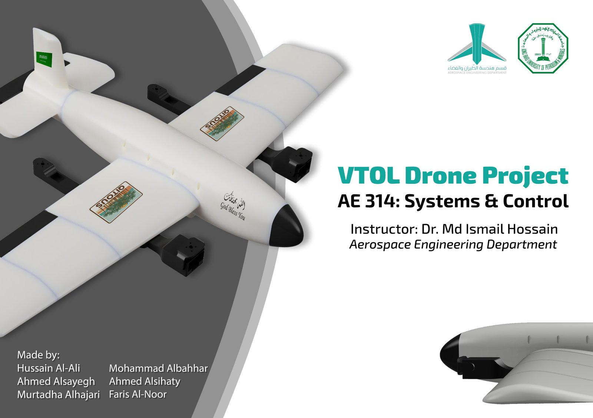

# QITOUS VTOL – 3D-Printed Hybrid VTOL Drone

Course project for **AE 314: Systems & Control**, Aerospace Engineering Department, King Fahd University of Petroleum & Minerals (KFUPM), December 2025.

> **Built on dRehmFlight by Nicholas Rehm.**
> The flight-control firmware in this repository is a modified version of [dRehmFlight](https://github.com/nickrehm/dRehmFlight) (Teensy, Beta 1.3), an open-source VTOL flight controller written by **Nicholas Rehm**. His code provides the core of the flight software: IMU drivers, the Madgwick attitude estimator, the PID controllers, radio decoding, failsafe and throttle-cut logic. All credit for that foundation goes to him. What we changed and added is listed in [What we built on top of dRehmFlight](#what-we-built-on-top-of-drehmflight) below.



QITOUS is a lightweight, four-propeller, 3D-printed VTOL aircraft that combines quad-rotor hover with fixed-wing forward flight. It takes off and lands in a small space like a multirotor, then lets the wing carry the load in forward flight, which needs much less power than flying on rotors alone and so gives longer endurance and range. It is driven by a **Teensy 4.0** flight controller and an **MPU6050** IMU.

**[Watch the project video](docs/QITOUS_VTOL_demo.mp4)**

## Project overview

The project covered the full engineering cycle, from sizing to a flying prototype:

1. **Planning:** requirements, constraints, sizing, and the choice of a four-propeller layout.
2. **Design:** parametric CAD of the airframe and wing airfoil in Fusion 360.
3. **Printing:** FDM 3D printing in segments to fit printer build volumes. PLA Aero keeps the large shells and wings light, and PLA+ is used where parts need strength (nose and control surfaces).
4. **Assembly:** mechanical build, wiring, electronics mounting, and vibration isolation for the IMU.
5. **Coding and testing:** adapting the dRehmFlight firmware to this airframe, bench tests without propellers, then progressive hover tests and gain tuning.

Main lessons: vibration and center-of-gravity placement had as much effect on stability as the control gains, and safe integration (arming logic, throttle cut, failsafes) was essential during testing.

## What we built on top of dRehmFlight

Stock dRehmFlight is a general-purpose flight controller: it ships with an example quadcopter mixer and default settings, and each builder adapts it to their own aircraft. Everything below is what we did to turn it into the QITOUS flight software. The changes are all in [`QITOUS_Teensy_7Dec.ino`](firmware/QITOUS_Teensy_7Dec/QITOUS_Teensy_7Dec.ino). `radioComm.ino` and the libraries in `src/` are unchanged from dRehmFlight Beta 1.3.

**1. Hover/cruise VTOL mixer (new).** The example quad mixer in `controlMixer()` was replaced with a two-mode mixer selected by the CH6 switch:

- **Hover (CH6 low):** X-quad mixing on all four motors, front motors tilted to vertical by their tilt servos, control surfaces held at trim.
- **Cruise (CH6 high):** front motors tilted forward to act as airplane propellers, with yaw from differential thrust; rear motors drop to a set idle (`rear_idle_cruise`); the elevator follows the pitch PID output scaled by an authority gain (`k_elev`).
- **Aileron test mode** (`AILERON_TEST_MODE`, enabled in this build): in cruise, the ailerons follow the roll stick directly, without the PID, so the surfaces could be checked safely before closing the loop on roll.
- New tuning parameters for tilt angles (`tilt_hover_deg`, `tilt_cruise_deg`), servo trims and centers, and surface authority (`k_elev`, `k_ail`).

**2. Radio setup for the FlySky FS-i6X.** Switched the receiver input from PWM to PPM (`USE_PPM_RX`) and remapped `getDesState()` to the FS-i6X AETR channel order (CH1 roll, CH2 pitch, CH3 throttle, CH4 yaw). The arming check in `armedStatus()` was updated to read throttle from CH3.

**3. Actuators and pin mapping for this airframe.** Reassigned the motor and servo pins to match the wiring (M1/M2 front tilt motors, M3/M4 rear fixed motors; servos for the two tilt mounts, elevator, and both ailerons). Inverted the front-right tilt servo, and added tighter output limits on the elevator and left aileron to protect the linkages. Motor outputs were changed from OneShot125 (125–250 µs) to standard 1000–2000 µs pulses to match our ESCs, and the startup `armMotors()` routine was disabled.

**4. IMU setup.** Configured for the MPU6050, ran dRehmFlight's `calculate_IMU_error()` on our airframe and stored the measured accelerometer and gyro offsets, guarded the magnetometer code so the sketch builds cleanly without a magnetometer, and added an X↔Z axis swap during the startup attitude warm-up for the board's mounting orientation.

**5. PID gain tuning.** Gains were tuned on the aircraft during bench and hover tests:

| Gain | dRehmFlight default | QITOUS |
|---|---|---|
| Roll angle Kp / Ki / Kd | 0.2 / 0.3 / 0.05 | 0.2 / 0.6 / 0.05 |
| Pitch angle Kp / Ki / Kd | 0.2 / 0.3 / 0.05 | 0.3 / 0.6 / 0.09 |
| Roll rate Kp / Ki / Kd | 0.15 / 0.2 / 0.0002 | 0.3 / 0.2 / 0.0015 |
| Pitch rate Kp / Ki / Kd | 0.15 / 0.2 / 0.0002 | 0.15 / 0.10 / 0.0005 |
| Yaw Kp / Ki / Kd | 0.3 / 0.05 / 0.00015 | 0.2 / 0.1 / 0.001 |

**6. Motor KV compensation (started).** Added scale factors for the mixed 935 KV front and 920 KV rear motors (see known limitations).

**Kept from dRehmFlight as-is:** Madgwick attitude estimation, the angle- and rate-mode PID controllers (including integrator hold at low throttle), gyro/accelerometer low-pass filtering, failsafe values, throttle cut, loop-rate timing, radio decoding, and all bundled libraries.

## How the project connects to AE 314

AE 314 (Systems & Control) teaches classical feedback control: how to model a system, analyze its response and stability, and design a controller for it. The course used a VTOL drone as its running example from the first lecture, with the same building blocks used here (FlySky transmitter and receiver, Teensy microcontroller, IMU, servos, and brushless motors). QITOUS is where the theory from each chapter was built and flown on real hardware:

| Course topic | Where it appears in QITOUS |
|---|---|
| **Ch. 1: Open- and closed-loop systems.** Identifying the process, sensor, actuator, and controller. | The aircraft is the process, the MPU6050 IMU is the sensor, the motors, ESCs, and servos are the actuators, and the Teensy 4.0 is the controller. Pilot sticks set the reference. |
| **Ch. 2: Modeling physical and electromechanical systems.** | Motor and servo response, and the coupling between thrust, center of gravity, and attitude. These drove the airframe layout and the motor KV compensation. |
| **Ch. 4: Block diagrams, error signals, sensitivity, and disturbances.** | The firmware loop: reference → error → controller → mixer → actuators → aircraft → IMU feedback. Vibration and gusts act as disturbances, and sensor noise is why the IMU signals are filtered. |
| **Ch. 5: Transient and steady-state response** (rise time, overshoot, settling time, steady-state error). | The criteria used to judge each tuning iteration during bench and hover tests: quick response, little overshoot, no steady drift. |
| **Ch. 6: Stability** (Routh–Hurwitz, absolute and relative stability). | Gains that were too high caused oscillation in hover, so gains were adjusted and output commands saturated to safe limits. |
| **Ch. 7: Root locus and PID control** (manual and Ziegler–Nichols tuning, roll and pitch angle control). | Roll and pitch run PID angle-mode loops and yaw runs a rate loop. The gains were tuned in steps the way the course does manual PID tuning (see the gain table above). |
| **Ch. 8: Frequency response and lead–lag design** (Bode plots, phase and gain margins, bandwidth). | The first-order low-pass filters on the gyro and accelerometer trade noise rejection against phase lag, which is the margin trade-off from this chapter. See [`analysis/lead_lag_controller_design.m`](analysis/lead_lag_controller_design.m) for the course's phase-lead design worked in MATLAB. |
| **Mode-dependent control.** | Hover and cruise use different actuator mixes, so the same controller outputs map to different actuators in each flight mode. |

## Key specifications

| Parameter | Value |
|---|---|
| Total mass | 2.1 kg |
| Battery | 14.8 V (4S) LiPo |
| Motors | 2× 935 KV (front, tilting) + 2× 920 KV (rear) brushless |
| Propellers | 4× 9×4×3 glass-fiber |
| Hover endurance | 10.61 min (estimated) |
| Forward speed | 8.6 m/s (estimated) |
| Range | 3.27 km (estimated) |
| Payload margin | 1.1 kg (estimated) |
| Materials | PLA Aero (airframe shells, wings), PLA+ (nose, control surfaces) |

## Firmware

Location: [`firmware/QITOUS_Teensy_7Dec/`](firmware/QITOUS_Teensy_7Dec/), an Arduino/Teensyduino sketch.

Architecture: RC input → IMU sampling and low-pass filtering → Madgwick attitude estimation → PID control (angle mode for roll/pitch, rate for yaw) → hover/cruise mixer → motors and servos.

Controls: CH5 is the throttle cut (high = motors off), CH6 switches between Hover and Cruise.

### Build and flash

1. Install the Arduino IDE and [Teensyduino](https://www.pjrc.com/teensy/td_download.html) (it provides `PWMServo`).
2. Open `firmware/QITOUS_Teensy_7Dec/QITOUS_Teensy_7Dec.ino`.
3. Select **Board: Teensy 4.0**, then upload.
4. Bench-test **with propellers removed** first: check IMU axes, RC mapping, arming and throttle cut, and motor order/direction.

### Known limitations

This is the version flown for the course in December 2025. Before reusing it on another aircraft, note:

- `armedFly` starts as `true`, so the motors can respond as soon as the board boots if CH5 is low. Always power up with the throttle cut switch on (CH5 high) and the throttle at zero.
- The motor KV compensation is applied before the mixer sets the motor commands, so it currently has no effect.
- The IMU X↔Z axis swap is only applied in the startup warm-up (`calibrateAttitude()`), not in the main loop.
- With `AILERON_TEST_MODE` disabled, the PID aileron branch refers to `ailR_center` / `ailL_center`, which are not defined (the defined variables are `ailR_center_deg` / `ailL_center_deg`), so that build will not compile until this is fixed.
- `printRollPitchYaw()` is left on for serial debugging.

## Hardware

Teensy 4.0, MPU6050, FS-i6X transmitter + PPM receiver, 4× brushless motors with ESCs, 5 servos (tilt and control surfaces), BEC, 4S LiPo, 1.2 mm steel push rods.

## 3D print files

The [`print-files/`](print-files/) folder holds the sliced print projects (`.3mf`) for the fuselage (including the landing-leg version), wing, ailerons with servo mounts and wingtip, tail, and engine mounts. Large shells and wings use PLA Aero, and the nose and control surfaces use PLA+.

## Repository layout

```
firmware/QITOUS_Teensy_7Dec/   Flight-controller firmware (Teensy 4.0), modified from dRehmFlight Beta 1.3
print-files/                   3D print projects (.3mf)
analysis/                      MATLAB lead-lag controller design (course exercise)
docs/                          Report, demo video, poster, and photos
```

## Documentation

- [Full project report (PDF)](docs/AE314_QITOUS_VTOL_Report.pdf): planning, CAD (Fusion 360), 3D printing, assembly, control theory, testing, and lessons learned.
- [Project poster](docs/images/poster.jpg)
- [Project video](docs/QITOUS_VTOL_demo.mp4)

## Team

- **Ahmed Bassim AlSayegh**: team leader; 3D printing and system programming, including the firmware changes described above.
- Mohammad Albabhar, Faris Al-Noor, Murtadha Alhajri, Hussain Al-Ali, Ahmed Alsihaty.

Instructor: Dr. Md Ismail Hossain.

## Credits and license

- **Flight-control firmware:** [dRehmFlight](https://github.com/nickrehm/dRehmFlight) by **Nicholas Rehm**. Thank you for making this project possible by releasing it as open source. Its original author header and credits are kept at the top of the sketch.
- **Bundled libraries** in `firmware/QITOUS_Teensy_7Dec/src/` (MPU6050/I2Cdev, MPU9250, SBUS, DSMRX, TFMPlus) belong to their original authors, as distributed with dRehmFlight.
- **License:** dRehmFlight is released under the GNU GPL v3, so this modified firmware is distributed under the same license (see [LICENSE](LICENSE)).
